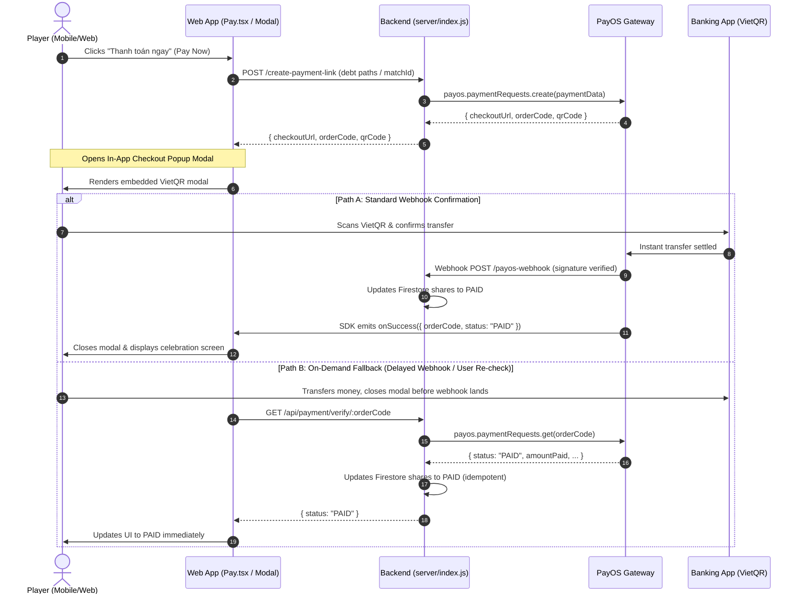

# PayOS In-App Embedded Checkout & Status Verification (v1)

> **Document Version**: 1.0  
> **Status**: Proposed / Planning Phase  
> **Target System**: Match Checkout (`server/index.js`, `web/src/pages/Pay.tsx`, `web/src/pages/PublicPortal.tsx`)  
> **Author**: Antigravity Pair Programming

---

## 1. Executive Summary & Priority Analysis

### Priority Rationale
Among all free PayOS capabilities, we recommend prioritizing:
**Phase 1: In-App Embedded Checkout Modal + On-Demand Verification Fallback**.

```
+---------------------------------------------------------------------------------+
|                               Feature Impact Matrix                             |
|                                                                                 |
|  Feature                             | UX Impact | Reliability | Implementation |
|  ----------------------------------- | --------- | ----------- | -------------- |
|  1. In-App Embedded Checkout Modal   |   VERY HIGH |     HIGH    |     Medium     |
|  2. On-Demand Status Verification    |     HIGH    |  VERY HIGH  |      Small     |
|  3. Stale Payment Link Cancel        |    Medium   |    Medium   |      Small     |
|  4. Mobile Banking App Deep Link     |     HIGH    |    Medium   |     Medium     |
|  5. Virtual Account Branded Prefix   |    Medium   |    Medium   |   Config/KYC   |
+---------------------------------------------------------------------------------+
```

### Why Bundle Embedded Checkout & Status Verification First?
1. **Immediate User Friction Reduction**: Today, clicking "Pay" completely navigates the player away from our app to `payos.vn`. Players lose their tab context, face redirection delays, and mobile browsers sometimes fail to redirect back cleanly.
2. **Ironclad Reliability (*Độ tin cậy vững chắc*)**: While the embedded modal captures `onSuccess` events via browser messages, relying solely on webhooks leaves room for dropped transactions if network latency spikes. Pairing embedded checkout with an **on-demand verification endpoint** (`payos.paymentRequests.get(orderCode)`) guarantees instant resolution for players and organizers.

---

## 2. Architecture & Transaction Flow



---

## 3. File Map Contract

| File | Action | Responsibility |
| :--- | :---: | :--- |
| `docs/plans/payos-in-app-checkout-and-verification-v1.md` | CREATE | This master plan & architecture contract |
| `web/tests/payos-checkout-and-verify.test.mjs` | CREATE | Automated mockup test suite for checkout & status verification |
| `server/index.js` | MODIFY | Add `GET /api/payment/verify/:orderCode` and export handler for test harness |
| `web/src/pages/Pay.tsx` | MODIFY | Integrate embedded checkout popup and "Verify Payment" fallback button |
| `web/src/pages/PublicPortal.tsx` | MODIFY | Integrate embedded checkout modal for public non-authenticated payers |
| `docs/index.md` | MODIFY | Register this plan in Master Wiki index |
| Firestore Rules & DB Schema | OFF-LIMITS | No breaking database schema or security rules changes needed |

---

## 4. Automated Mockup Test Plan

The project contains a zero-dependency, ultra-fast test runner using Node.js built-in `node:test` (`web/tests/payment-server.test.mjs`). We will implement an automated mockup test suite in `web/tests/payos-checkout-and-verify.test.mjs`.

### Test Scenarios Matrix

```
+-------+-----------------------------------------------+-----------------------------------------+
| ID    | Test Scenario                                 | Expected Behavior                       |
+-------+-----------------------------------------------+-----------------------------------------+
| TM-01 | Create payment link response contract         | Returns checkoutUrl & orderCode         |
| TM-02 | Verify endpoint when PayOS returns "PAID"     | Marks match shares as PAID in Firestore |
| TM-03 | Verify endpoint when PayOS returns "PENDING"  | Leaves shares PENDING, no writes        |
| TM-04 | Verify endpoint idempotency (Already PAID)    | Returns 200 OK without re-notifying     |
| TM-05 | Webhook + Manual Verify concurrency           | No duplicate notifications or credits   |
| TM-06 | Verify endpoint with invalid/missing orderCode| Returns 404/400 with clean error JSON   |
| TM-07 | Cancel payment link via API                   | Invokes payos.paymentRequests.cancel()  |
+-------+-----------------------------------------------+-----------------------------------------+
```

### Mock Infrastructure Details
- **Mock PayOS SDK**:
  ```javascript
  const mockPayOS = {
    paymentRequests: {
      create: async (data) => ({ checkoutUrl: "https://payos.test/checkout", orderCode: data.orderCode }),
      get: async (orderCode) => ({ status: statusByOrder.get(orderCode) || "PENDING", orderCode }),
      cancel: async (orderCode) => ({ status: "CANCELLED", orderCode })
    },
    webhooks: {
      verify: async (body) => body
    }
  };
  ```
- **Mock Firestore**: Reuses `fake-firestore.mjs` / records map established in `web/tests/payment-server.test.mjs`.

---

## 5. Phased Implementation Roadmap

### Phase 1: Automated Mockup Tests & Backend Verification Endpoint
1. Create `web/tests/payos-checkout-and-verify.test.mjs` defining all 7 test cases.
2. Implement `GET /api/payment/verify/:orderCode` in `server/index.js` using `payos.paymentRequests.get(orderCode)`.
3. Run automated tests to verify 100% green pass.

### Phase 2: Frontend Embedded Checkout Integration
1. Inject the lightweight PayOS checkout script / hook loader in `web/src/pages/Pay.tsx` and `web/src/pages/PublicPortal.tsx`.
2. Replace `window.location.href = checkoutUrl` with `payosCheckout.open()`.
3. Handle `onSuccess`, `onExit`, and `onCancel` callbacks.
4. Add a fallback "Kiểm tra thanh toán" (Re-check status) button with spinning loading state for any bills that remain pending.

### Phase 3: Documentation & Master Wiki
1. Update `docs/index.md` to link this plan.
2. Verify all test suites pass across the workspace.
