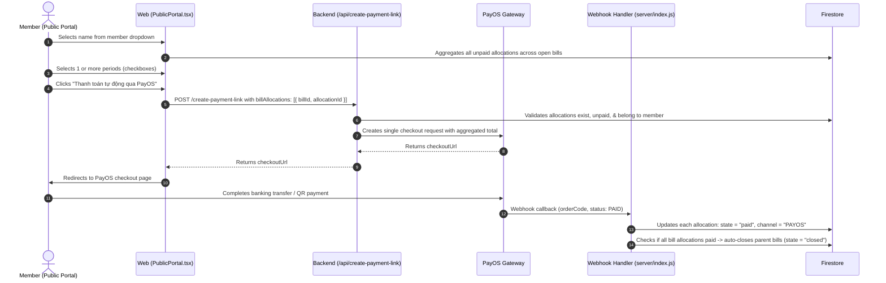

# Shared Bills Consolidation, Subscription Catch-Up & Platform Settlement (v1)

> **Document Version**: 1.0  
> **Status**: Completed & Deployed to Production  
> **Scope**: PayOS Consolidation, Subscription Automation, Sidebar Navigation, Platform Settlement Reconciliation & Super Admin Member Linking  
> **Date**: 2026-10-24  
> **Author**: Antigravity Pair Programming

---

## 1. Overview & Core Motivation

This document details the architectural decisions and implementation specifications for four interrelated core modules:
1. **Shared Bills Debt Consolidation (*Gom nợ nhiều kỳ*)**: Enabling members to pay multiple unpaid billing periods in a single PayOS transaction or VietQR transfer.
2. **Instant Subscription Catch-Up & Simplified Due Dates**: Eliminating the conflicting "Số ngày chờ thanh toán" (`dueOffsetDays`) and automatically generating bills for past/current periods upon subscription save.
3. **Structured Sidebar Navigation**: Organizing admin menus into logical, accessible sections with visual hierarchy.
4. **Platform Settlement Collection Badges & Super Admin Linking**: Transparently tracking participant payment progress per match and allowing the Super Admin to claim their member alias with 1-click, preventing duplicate self-refunds.

---

## 2. Shared Bills Debt Consolidation (*Gom nợ nhiều kỳ*)

### Problem Statement
In recurring shared expenses (e.g. Netflix, Spotify, cloud server subscriptions), members frequently consolidate and pay for multiple months at once (e.g., September + October). Previously, payments were strictly one-bill-at-a-time, creating friction and excessive transaction fees.

### Architecture & Data Flow

### Fallback: Dynamic VietQR
If PayOS checkout is not preferred, the UI dynamically renders a VietQR containing:
- Exact consolidated amount (`totalSelected`).
- Account number, bank name, and account holder.
- Customized transfer memo: `[MemberName] [BillTitles...]`.
- Copy-to-clipboard buttons for account number and exact VND amount.

---

## 3. Subscription Catch-Up & Due Offset Cleanup

### Removal of `dueOffsetDays`
- Previously, the subscription form required entering "Số ngày chờ thanh toán" (`dueOffsetDays`). This caused artificial due dates and conflicted with multi-period debt consolidation.
- **Decision**: Removed `dueOffsetDays` from the UI form (`BillForm.tsx`). Defaulted internally to `0`.

### Immediate Bill Generation on Save (*Catch-Up*)
- When a manager creates or updates a recurring subscription whose `startMonth <= currentMonth`:
  - Saving the subscription now automatically calls `POST /groups/:groupId/subscriptions/run-now`.
  - Backend iterates from `startMonth` up to the current month, generating any missing bill documents immediately.
  - Newly generated bills show up on the Public Portal without waiting for the daily cron job.
- Added a manual **"Chạy tạo kỳ thu ngay" (*Run Now*)** button in the Subscriptions management tab header.

---

## 4. Sidebar Navigation Sections

To improve UX across all group types, `AdminLayout.tsx` groups navigation items into clear, uppercase-headed sections:

### For Shared Bills Groups (`group.kind === "shared_bills"`):
- **KHOẢN THU**:
  - `Thu định kỳ` (`admin/bills?tab=recurring`)
  - `Kỳ thu & Một lần` (`admin/bills?tab=monthly`)
  - `Lịch sử thanh toán` (`admin/bill-history`)
- **TỰ ĐỘNG HOÁ**:
  - `Nhắc nợ tự động` (`admin/bills?tab=reminders`)
- **QUẢN LÝ NHÓM**:
  - `Thành viên` (`admin/members`)
  - `Trang Public` (`public`)
  - `Cấu hình` (`admin/config`)
- **HỆ THỐNG** *(if Platform Account)*:
  - `Nền tảng` (`/platform`) with `LayoutGrid` icon

### For Sports Groups (`group.kind === "sports"`):
- **HOẠT ĐỘNG**: `Quản lý Trận đấu`, `Chấm điểm`, `Ghi chú live`
- **QUẢN LÝ NHÓM**: `Thành viên`, `Trang Public`, `Cấu hình`
- **HỆ THỐNG**: `Nền tảng` *(if Platform Account)*

---

## 5. Platform Settlement Reconciliation & Super Admin Linking

### The Cash Flow Reality
- All member payments via PayOS flow directly into the **Platform Super Admin's bank account**.
- When a **Group Manager** or **Another Member** pays for the court, the Super Admin must reimburse them.
- However, when the **Super Admin himself** is selected as the court payer, the member funds are already in the Super Admin's possession. **No reimbursement is required.**

### 1. Collection Progress Flags per Match
For every pending match in `/platform/settlement/overview`, the backend reads `matches/{matchId}/shares` and calculates:
- `collectedAmount`: Total VND collected from participants (`status === "PAID"`).
- `totalShareAmount`: Total VND expected from all shares.
- `pendingSharesCount`: Number of participants who have not paid.
- `isFullyCollected`: `true` if `pendingSharesCount === 0` and `totalShareAmount > 0`.

**Visual Status Badges**:
- 🟢 **Đã thu đủ (350.000đ)**: 100% collected from participants.
- 🟡 **Mới thu X / Y VND (còn Z người)**: Partially collected.
- ⚪ **Chưa thu được tiền (0đ)**: Zero participants have paid yet.

**Safety Interlocks**:
- Clicking "Đã hoàn" on a match that is not fully collected triggers a confirmation dialog warning of potential deficit.
- Clicking "Xác nhận đã chuyển tất cả" warns if any matches in the group are uncollected.

### 2. 1-Click Super Admin Member Claiming (`isPlatformOwner`)
Because members in groups do not have user accounts or emails, and the Super Admin may use different nicknames in different groups (e.g. `Thiên Bún`, `Bún`, `Quốc Thiên`):

- **Endpoint**: `POST /platform/settlement/link-owner-member`
  - **Permission**: Strict `requireOwner` (only Super Admin can call).
  - **Payload**: `{ groupId, memberId, isPlatformOwner: boolean }`.
  - **Action**: Persists `isPlatformOwner: true` on `members/{memberId}` document.
- **UI Behavior**:
  - In the Reconciliation modal, unlinked payers have a button:  
    ⭐ **`Đây là tôi (Super Admin)`**.
  - Clicking this button immediately marks the member as:  
    `👑 Người ứng: [Name] (Bạn - Super Admin) (Đã tự giữ tiền PayOS - Không cần hoàn)`.
  - The match total is **automatically excluded from the group's and platform's "Tổng tiền cần hoàn"**.
  - A button **"Hủy liên kết"** is available if the user ever needs to revert the claim.

---

## 6. Verification & Test Evidence

- **Unit Test Suite**: `node --test web/tests/*.test.mjs` — **220/220 passing (100%)**.
- **Frontend Build**: `npm run build` in `web/` completes with 0 errors.
- **Cloud Run Deployment**: `functions[api(us-central1)]` updated on Google Cloud.
- **Hosting Deployment**: `hosting[thienbun-payment]` deployed and live on Firebase.
