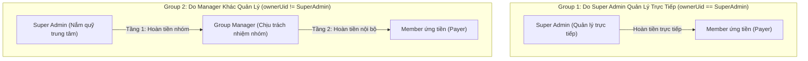

# Shared Bills: Roles, Settlement, and Multi-Tier Payer Reconciliation (v2)

> **Document Version**: 2.0  
> **Status**: Aligned with User Governance Model  
> **Target System**: Shared Bills Module (`groups/{gid}/bills` & `subscriptions`)  
> **Author**: Antigravity Pair Programming

---

## 1. Governance Model & Group Custodianship

There are two distinct types of groups on the platform:



### The 2 Settlement Relationships:
1. **Group do Super Admin quản lý trực tiếp (`group.ownerUid === superAdmin.uid`)**:
   * Super Admin vừa là chủ tài khoản trung tâm, vừa là Group Manager.
   * Khi một Member bất kỳ ứng tiền (ví dụ Member A quẹt thẻ trả Netflix 260k):
   * **Super Admin hoàn tiền trực tiếp cho Member A**.
   * Luồng: `Super Admin ──(hoàn tiền trực tiếp)──> Member`

2. **Group KHÔNG phải do Super Admin quản lý (`group.ownerUid !== superAdmin.uid`)**:
   * Quỹ thu về tài khoản trung tâm của Super Admin.
   * Super Admin **KHÔNG** làm việc trực tiếp với từng member của nhóm người khác.
   * **Tầng 1 (Super Admin $\rightarrow$ Group Manager)**: Super Admin đối soát và hoàn tiền cho **Group Manager**.
   * **Tầng 2 (Group Manager $\rightarrow$ Member ứng tiền)**: Group Manager nhận tiền từ Super Admin rồi tự hoàn trả lại cho Member đã ứng tiền (nếu chính Manager ứng thì xong ở Tầng 1).
   * Luồng: `Super Admin ──(đối soát)──> Group Manager ──(hoàn trả nội bộ)──> Member`

---

## 2. Settlement Mode: Thu Đủ 100% vs Khấu Trừ

Khi Bill là **260,000 VND** cho 5 người (**52,000 VND / người**):

### Phương án A (Mặc định): Thu đủ 100% rồi Hoàn toàn bộ (*Gross Collection - `full_collection`*)
* **Cả 5 người (bao gồm người ứng)** đều chuyển 52.000 VND vào tài khoản Super Admin.
* Tài khoản Super Admin nhận đủ đúng **260.000 VND**.
* Super Admin chuyển hoàn đúng **260.000 VND**:
  * Nếu nhóm do Super Admin quản lý: chuyển 260.000 VND cho Member ứng tiền.
  * Nếu nhóm do Manager quản lý: chuyển 260.000 VND cho Group Manager (Group Manager chuyển 260.000 VND cho Member ứng tiền).
* **Lợi ích**:
  * Sao kê tài khoản khớp hoàn hảo (Vào 260k = Ra 260k).
  * Không cần tính nhẩm trừ ra trừ vào.
  * Thông báo Telegram & Trang Public đồng nhất (tất cả thành viên đều đóng 52k).

### Phương án B: Khấu trừ nội bộ (*Net Offset - `net_offset`*)
* Người ứng được tự trừ 52k (không đóng tiền).
* 4 thành viên còn lại chuyển 4 × 52k = **208.000 VND** vào tài khoản Super Admin.
* Super Admin hoàn trả **208.000 VND** cho người nhận tương ứng (Member hoặc Manager).

---

## 3. Payer Reconciliation Data Model (*Cấu trúc dữ liệu đối soát*)

Mỗi Bill sẽ lưu trữ thông tin đối soát phân tầng:

```typescript
interface BillReconciliation {
  // Tầng 1: Super Admin -> Người phụ trách
  tier1Payout: {
    status: "NOT_REQUIRED" | "PENDING_COLLECTION" | "READY_FOR_PAYOUT" | "SETTLED";
    recipientRole: "DIRECT_MEMBER" | "GROUP_MANAGER";
    recipientUidOrMemberId: string;
    recipientName: string;
    amountVnd: number;
    bankInfo?: { bankCode: string; accountNumber: string; accountName: string };
    settledAt?: { seconds: number } | null;
    settledByUid?: string | null;
    transactionReference?: string;
  };

  // Tầng 2 (Chỉ có khi Group do Manager quản lý và Member ứng tiền khác Manager):
  tier2Payout?: {
    status: "PENDING" | "SETTLED";
    memberId: string;
    memberName: string;
    amountVnd: number;
    bankInfo?: { bankCode: string; accountNumber: string; accountName: string };
    settledAt?: { seconds: number } | null;
    transactionReference?: string;
  };
}
```

---

## 4. Giao diện người dùng theo phân quyền (UI Workflow)

### 4.1 Với Super Admin (Màn hình chi tiết Bill & Đối soát nền tảng)
* **Nếu là nhóm của Super Admin**:
  * Card: **"Đối soát: Hoàn tiền trực tiếp cho thành viên ứng"**
  * Nút: `Mở VietQR chuyển tiền cho Member X` + `Xác nhận đã hoàn tiền`.
* **Nếu là nhóm của Manager khác**:
  * Card: **"Đối soát: Hoàn tiền cho Quản trị viên nhóm (Group Manager)"**
  * Nút: `Mở VietQR chuyển tiền cho Manager` + `Xác nhận đã hoàn tiền cho Manager`.
  * Sau khi Super Admin xác nhận, trạng thái Tầng 1 chuyển sang `SETTLED`.

### 4.2 Với Group Manager (Màn hình chi tiết Bill của nhóm họ)
* Manager thấy trạng thái:
  * *"Chờ Super Admin chuyển tiền"* $\rightarrow$ *"Super Admin đã chuyển hoàn"*.
* Nếu người ứng tiền là một **Member khác trong nhóm**:
  * Manager thấy thêm Card: **"Hoàn tiền nội bộ cho [Tên Member]"**
  * Manager bấm mở VietQR của Member đó và bấm `Xác nhận đã trả tiền cho Member`.

---

## 5. API Endpoints

- `POST /groups/:groupId/bills/:billId/settle-tier1`: Xác nhận hoàn tiền Tầng 1 (Super Admin hoàn cho Member hoặc Manager).
- `POST /groups/:groupId/bills/:billId/settle-tier2`: Xác nhận hoàn tiền Tầng 2 (Group Manager hoàn cho Member ứng tiền).
